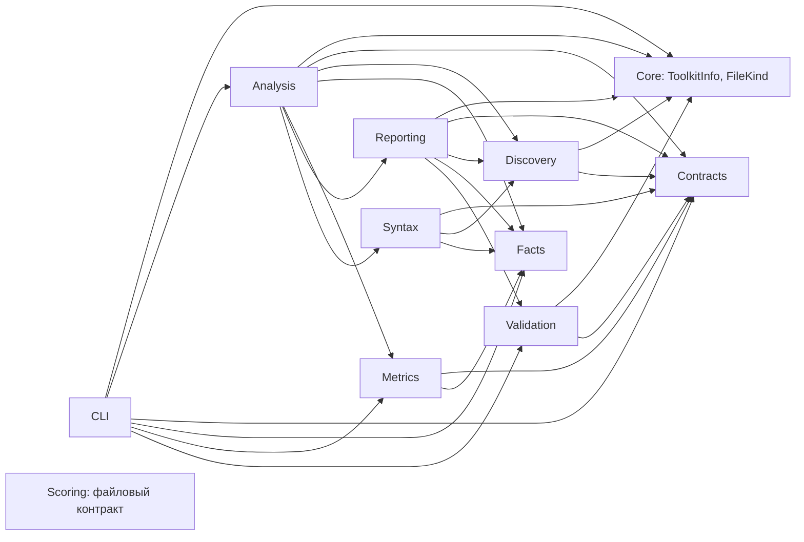
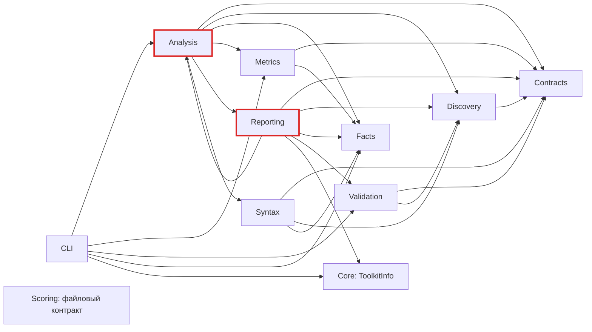

# Структура, процессы и проверка графа

Исходная проверка от 2026-10-23, commit `9c45d50ada0ea1ba2e1bd6378e00cb303aeb36a3`.
Область: три production-проекта в `src`, без тестов и generated-кода. На этапе исходного аудита production-код не изменялся.

**Находки исходного аудита (исправлены ниже):** воспроизводимая бесконечная рекурсия в `AddCoupledType` и архитектурный цикл `Analysis ↔ Reporting`. Уровень проектов ацикличен; Scoring отделён файловым контрактом.

## Исправления и повторная проверка

- `AddCoupledType` обходит типы через `Stack<ITypeSymbol>` и множество посещённых
  символов с `SymbolEqualityComparer.Default`. Символ отмечается до обхода потомков;
  `OriginalDefinition` используется только для итогового coupling, поэтому
  `Box<First>` и `Box<Second>` сохраняют оба аргумента.
- `AnalyzeRequest` перенесён в `Core.Contracts`, `AnalysisSummary` — в `Core.Facts`.
  `Reporting → Analysis` устранён без новых проектов или интерфейсов.
- Общий `FileKind` перенесён в корень Core без изменения проверок и обработки ошибок.
  `Validation` больше не зависит от `Discovery`.
- CLI, JSON-схемы и версии формул сохранены. Source-потребители двух публичных
  C#-моделей должны обновить пространства имён.

Повторный semantic analysis production-исходников: **trusted / msbuild /
trustedDiagnostics=true**, 86 файлов, 159 типов, 699 членов, 18 349 строк метрик.
Данные: [graph-audit-fixed.json](graph-audit-fixed.json).

| Проверка | До | После |
| --- | ---: | ---: |
| Циклические компоненты namespace (> 1 вершины) | 1 | **0** |
| Namespace-рёбра | 25 | 27 |
| Рёбра calls | 662 | 661 |
| Петли calls | 4 | **3** |
| Повторные рёбра / отсутствующие концы | 0 / 0 | 0 / 0 |

Рост числа namespace-рёбер объясняется прямыми ссылками на общие модели и файловый
примитив. Удаление необходимых связей ради меньшего числа рёбер не выполнялось.
Оставшиеся три рекурсивных вызова описаны в исходном аудите ниже; дефектов завершения
в них не подтверждено. ProjectReference и namespace-графы ацикличны.

Тесты до исправления: **3 failed, 10 passed, 0 skipped** — дочерний CLI упал со
`Stack overflow`, обе новые проверки границ выявили запрещённые зависимости.
После исправления той же командой: **13 passed, 0 failed, 0 skipped**.

```sh
dotnet test tests/CodeMetricsToolkit.Tests/CodeMetricsToolkit.Tests.csproj -c Release --no-restore \
  --filter 'FullyQualifiedName~TypeSemanticFactsCollectorTests|FullyQualifiedName~AnalyzeRecursiveGenericConstraints|FullyQualifiedName~DependencyBoundaryTests'
```

Regression fixture сохранён в
[RecursiveConstraintsProject](../../tests/CodeMetricsToolkit.TestAssets/RecursiveConstraintsProject/Sample.cs).
Тест запускает CLI отдельно, проверяет успешный выход, trusted-диагностику и coupling=1.
Отдельный unit test проверяет `Pair<Box<First[]>, Box<Second>>`: coupling=4.

Полный граф пространств имён после исправления:



## Схемы

1. [Границы системы и обмен данными](01-system.html) — architecture: ссылки проектов и потоки файлов подписаны отдельно.
2. [Core после устранения цикла](02-core-cycle.html) — architecture: общие модели в нижних слоях.
3. [Процесс анализа и решение CLI](03-analysis.html) — workflow: semantic/syntax-only, метрики, публикация, exit gate.
4. [Замена поколения и восстановление](04-publication.html) — workflow: существующий output, staging, валидация, backup и откат.

HTML автономны, поддерживают масштабирование и экспорт. Содержание русское; фиксированный интерфейс Viewer и `<html lang>` используют английский fallback Archify. Неподписанные workflow-рёбра означают обычный переход к следующему этапу: дополнительный текст повторил бы названия узлов. Схемы процессов показывают основные ветви, а не все catch-блоки; ошибки ввода и отмена возможны и до публикации.

## Исходный аудит до исправления

Далее сохранены исходные измерения и обоснования находок на commit `9c45d50`.
Описания дефектов и номера строк относятся к этой версии; текущее состояние приведено выше.

Полный исходный граф пространств имён ниже. Стрелка означает использование символов, а не передачу данных. Scoring изолирован в графе ссылок кода, но связан с продуктом через артефакты.



## Измерения

Собранный из текущих исходников CLI выполнил semantic analysis `src --no-restore`: `trusted`, `msbuild`, `trustedDiagnostics=true`; 86 файлов, 159 типов, 699 членов, 18 349 строк метрик. SDK окружения — 10.0.401, Roslyn — 5.6.0.

Графы выделены по типу связи; `contains` и `declares` не смешивались с зависимостями, чтобы не создавать циклы с неоднозначным смыслом.

| Граф | Узлы | Рёбра | SCC размером > 1 | Петли |
| --- | ---: | ---: | ---: | ---: |
| ProjectReference | 3 | 1 | 0 | 0 |
| Namespace / depends_on | 11 | 25 | 1: Analysis + Reporting | 0 |
| Прямые вызовы членов / calls | 699 | 662 | 0 | 4 |

Во всём артефакте **959 узлов, 2 952 ребра**. Повторов `(from, to, kind, confidence)` — 0; отсутствующих концов рёбер — 0. Данные: [graph-audit.json](graph-audit.json), воспроизводимая проверка: [check_graph.py](check_graph.py). Полный исходный граф сохранён локально в `artifacts/architecture-review/self-analysis/graph.json`; его SHA-256 включён в результаты.

Ограничения: коллектор исключает namespace-зависимости на себя. Граф calls не моделирует все динамические вызовы, callbacks, reflection, property access и неявные вызовы. Поэтому 268 изолированных member-узлов **не означают 268 мёртвых методов**, а отсутствие многовершинного цикла не доказывает отсутствие всех циклов выполнения. `trusted` означает полноту загрузки в рамках модели инструмента.

## Находки

### 1. Высокий приоритет: бесконечная рекурсия generic constraints

**Подтверждено отдельным процессом.** В [TypeSemanticFactsCollector.cs](../../src/CodeMetricsToolkit.Core/Syntax/TypeSemanticFactsCollector.cs), строки 187–220, `AddCoupledType` рекурсивно обходит `ConstraintTypes` и `TypeArguments` без проверки посещённых символов. `couplingKeys` пополняется после рекурсии и не является защитой от повторного входа.

Минимальный корректный C#:

```csharp
namespace RecursiveGeneric;
public sealed class Sample<T> where T : System.IComparable<T>
{
    public T Echo(T value) => value;
}
```

Цикл данных: `T → IComparable<T> → T`. Fixture успешно собран для net10.0. Semantic analyze завершился `Stack overflow`, SIGABRT (`subprocess.returncode = -6`); в стеке повторяется `AddCoupledType`. Это аварийное завершение процесса, а не degraded-результат. См. [результат воспроизведения](recursion-reproduction.json).

Предлагаемое исправление: отмечать посещённые `ITypeSymbol` через `SymbolEqualityComparer.Default` до обхода ограничений/аргументов. Нужен regression test с рекурсивным ограничением и проверкой сохранения учёта разных конкретных generic-аргументов. До исправления такой тест следует запускать в отдельном процессе, чтобы не уничтожать test runner. В рамках аудита исправление не вносилось.

Контракт символов запрошен через Context7; выдача оказалась общей, поэтому дополнительно проверена официальная документация, включающая версию 5.6.0: [ConstraintTypes](https://learn.microsoft.com/dotnet/api/microsoft.codeanalysis.itypeparametersymbol), [TypeArguments](https://learn.microsoft.com/dotnet/api/microsoft.codeanalysis.inamedtypesymbol). Сам дефект подтверждён локальным запуском Roslyn 5.6.0.

### 2. Средний приоритет: Reporting зависит от Analysis

[CodeMetricsAnalyzer.cs](../../src/CodeMetricsToolkit.Core/Analysis/CodeMetricsAnalyzer.cs), строка 79, вызывает `ArtifactWriter.WriteAsync`. [ArtifactWriter.cs](../../src/CodeMetricsToolkit.Core/Reporting/ArtifactWriter.cs), строки 32 и 174, принимает `AnalyzeRequest` и вызывает `AnalysisSummary.Create` из Analysis. Так образуется SCC из двух пространств имён. Это связанность слоёв, а не взаимная рекурсия этих классов.

Оценка: сериализация знает о моделях orchestration больше, чем желательно. Для устранения цикла достаточно разместить общие модели запроса/summary в подходящем существующем нижнем слое и обновить потребителей. Новые проекты, DI-интерфейсы или сервисы не нужны. Перемещение публичных типов потребует обновления импортов source-потребителей; это отдельный рефакторинг, не механическое удаление ребра.

### 3. Баланс зависимостей

Fan-in — число зависящих пространств имён; fan-out — число используемых. Универсального порога «здоровья» здесь нет.

| Узел | Fan-in | Fan-out | Интерпретация |
| --- | ---: | ---: | --- |
| Analysis | 2 | 6 | Координация объясняет высокий fan-out |
| Reporting | 1 | 6 | Сравним с оркестратором; обратная связь с Analysis заслуживает устранения |
| CLI | 0 | 5 | Несколько команд и exit gates |
| Contracts | 6 | 0 | Общая независимая основа |
| Facts | 5 | 0 | Пассивные факты, обратных связей нет |
| Discovery | 4 | 1 | Модели входа и файловые проверки используются несколькими слоями |
| Metrics | 2 | 2 | Только Facts и Contracts — узкая граница |
| Syntax | 1 | 3 | Facts, Contracts, Discovery |
| Validation | 2 | 2 | Contracts и файловый примитив Discovery |

`AnalyzeAsync` имеет 16 разных внутренних целей вызова, `SemanticWorkspaceLoader.LoadAsync` — 14, `AnalysisFactsCollector.CollectAsync` — 13. Это точки концентрации изменений; число рёбер не измеряет CPU, задержку или память. Крупнейшие файлы: ScoringArtifactReader — 850 строк, AnalysisFactsCollector — 695, SourceFileDiscovery — 666. Размер сам по себе не обосновывает дробление классов.

### 4. Транзитивные связи не равны лишним

Для **12 из 25** namespace-рёбер есть другой путь до того же узла при удалении конкретного ребра. Перечень: `namespace.alternate_path_edges` в JSON. Это свойство достижимости; у циклического графа нет единственного канонического transitive reduction.

`CLI → Metrics` нужен list-metrics/explain, хотя существует путь через Analysis. `CLI → Validation` нужен validate-output. Прямые зависимости на Facts и Contracts нужны используемым типам. Удаление таких связей из кода не обосновано.

`Validation → Discovery` существует ради `FileKind.IsRegularFile` ([OutputValidator.cs](../../src/CodeMetricsToolkit.Core/Validation/OutputValidator.cs), строка 122). Возможное улучшение — точнее разместить файловый примитив при будущей работе с границами. Цикла эта связь не создаёт; дублировать защитную проверку ради меньшего fan-out не следует.

### 5. Остальные петли и процесс публикации

| Петля calls | Оценка |
| --- | --- |
| InputIsolator.CopyDirectory | Глубина увеличивается, предел 96; reparse points пропускаются |
| TypeSemanticFactsCollector.AddCoupledType | Подтверждённый дефект, находка №1 |
| EmbeddedSchemaValidator.EnumerateResults | Обход дерева результатов; явных возвратов к предку в коде нет; экстремальная глубина не испытывалась |
| GlobMatcher.Match | Индексы pattern/path растут, результаты мемоизируются; бесконечная рекурсия не найдена, предельно длинные строки не испытывались |

Основной процесс анализа выполняется вперёд: факты → проекторы → ranking → публикация. Degraded — маркировка неполноты загрузки, не повтор анализа. CLI может вернуть код 3 **после** публикации: наличие файлов не означает принятие результата.

Публикация: запись staging (manifest последним) → схемы и инварианты → output в backup → staging в output → удаление backup. При сбое переноса — одна попытка отката и исключение наружу. При сбое отката старые данные остаются в backup; неудачное удаление backup после успешного переноса возвращает warning. При первом запуске backup не нужен. См. [ArtifactDirectoryPublisher.cs](../../src/CodeMetricsToolkit.Core/Reporting/ArtifactDirectoryPublisher.cs), строки 296–350.

Это не транзакция для конкурентных читателей: между двумя `Directory.Move` output может отсутствовать. Поддерживаемая модель требует читать после завершения analyze ([Scoring README](../../src/CodeMetricsToolkit.Scoring/README.md)). Откат не является лишним retry-циклом.

Scoring-профиль тоже выполняется вперёд: weightedSum принимает только уже зарегистрированные outputs; обратные ссылки отвергаются до вычисления ([ScoringProfileParser.cs](../../src/CodeMetricsToolkit.Scoring/ScoringProfileParser.cs), строки 356–391).

## Проверки и воспроизведение

- Release build прошёл: 0 предупреждений, 0 ошибок.
- 22 теста `DependencyBoundaryTests`, `ArtifactDirectoryPublisherTests`, `CliAnalyzeArchitectureTests` прошли.
- Self-analysis: trusted, publisher проверил схемы и инварианты.
- Assert self-check аналитического скрипта прошёл: направление, SCC, петли, изоляты, обходные пути.
- Generic fixture успешно собран; аварийное завершение analyze воспроизведено отдельно.

```sh
dotnet build CodeMetricsToolkit.sln --configuration Release --no-restore
dotnet src/CodeMetricsToolkit.Cli/bin/Release/net10.0/CodeMetricsToolkit.Cli.dll \
  analyze src --no-restore --output artifacts/architecture-review/self-analysis
python3 docs/architecture-review/check_graph.py \
  artifacts/architecture-review/self-analysis/graph.json
```

Fixture находится локально в `artifacts/architecture-review/recursive-generic`; лог — `artifacts/architecture-review/recursive-generic.log`. Его содержимое приведено выше. Чтобы повторить, создайте обычный net10.0 library project с этим классом, выполните build и analyze его csproj в отдельном процессе.

На этапе исходного аудита полный test suite, нагрузочное профилирование и все динамические вызовы не проверялись. Подтверждённые находки затем исправлены, как описано в начале отчёта.

## Проверка схем

Все четыре HTML прошли 9/9 showcase-проверок: 0 ошибок и 0 предупреждений. Автоматическая проверка Chrome: 1440×900, 1600×1000, 1920×1080, 2048×1320 — без переполнения. Скриншоты обеих тем просмотрены: подписи читаются, пересечений рёбер с узлами не обнаружено. Вручную взаимодействие с поиском, focus и экспортом не проверялось.

[Сводная квитанция](delivery-summary.json) содержит типы диаграмм, абсолютные пути, SHA-256 спецификаций и HTML, статусы browser_evidence / visual_review и число раундов исправлений. Подробные квитанции и скриншоты лежат рядом с HTML. Исходный Mermaid-граф сверён с 25 семантическими namespace-рёбрами, текущий — с 27. Схема №2 перегенерирована после исправления и повторно проверена. Циклы остались только в сохранённом исходном Mermaid-графе; четыре актуальные HTML-схемы ацикличны.
