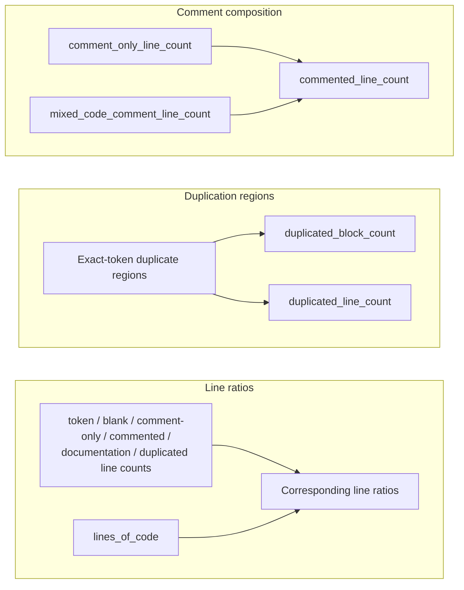
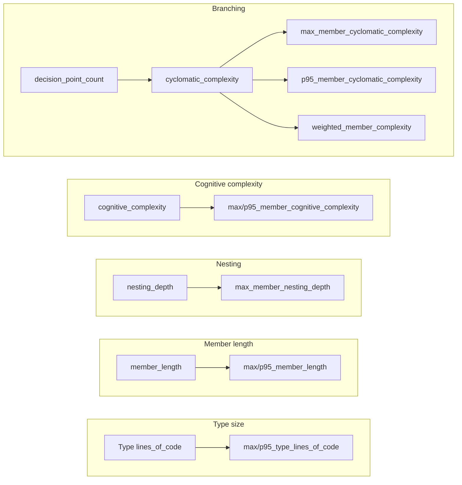
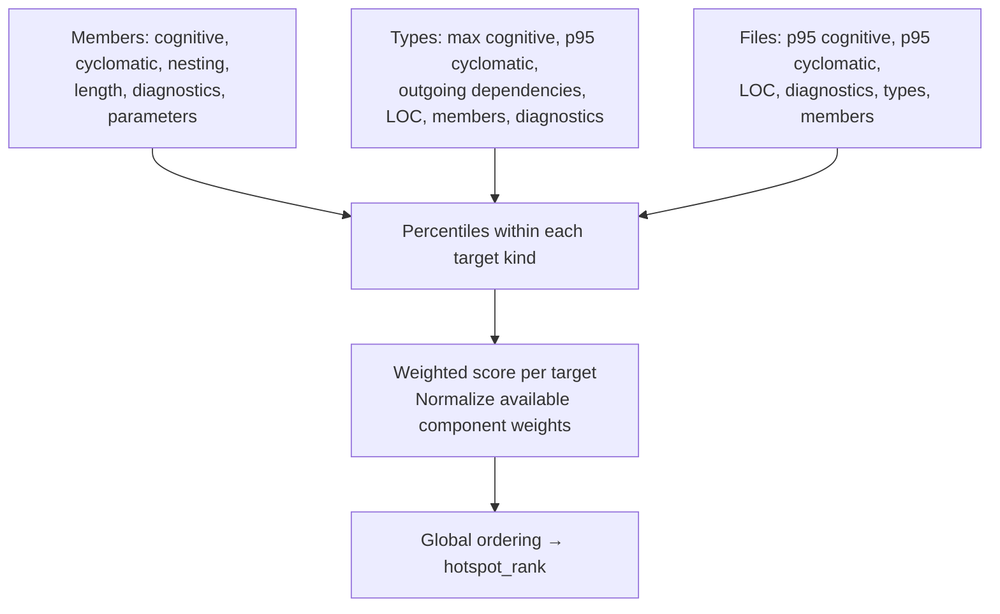
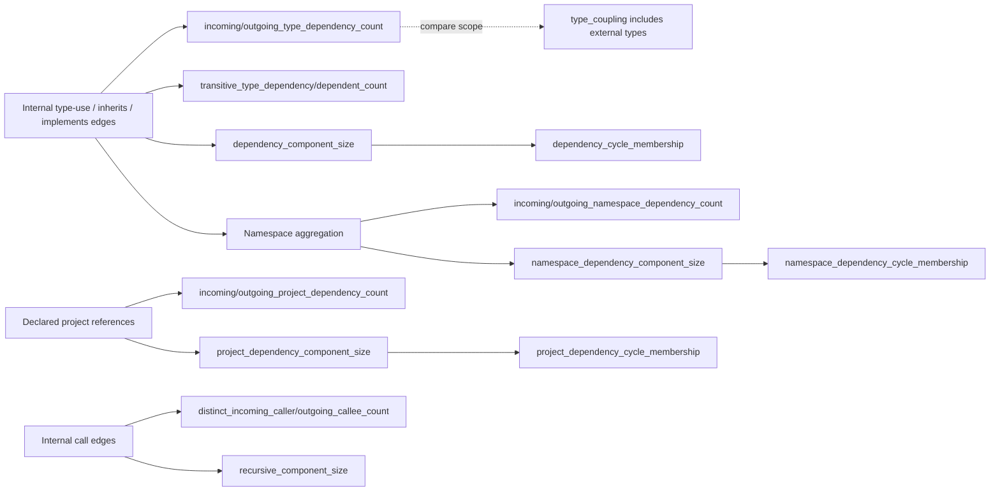
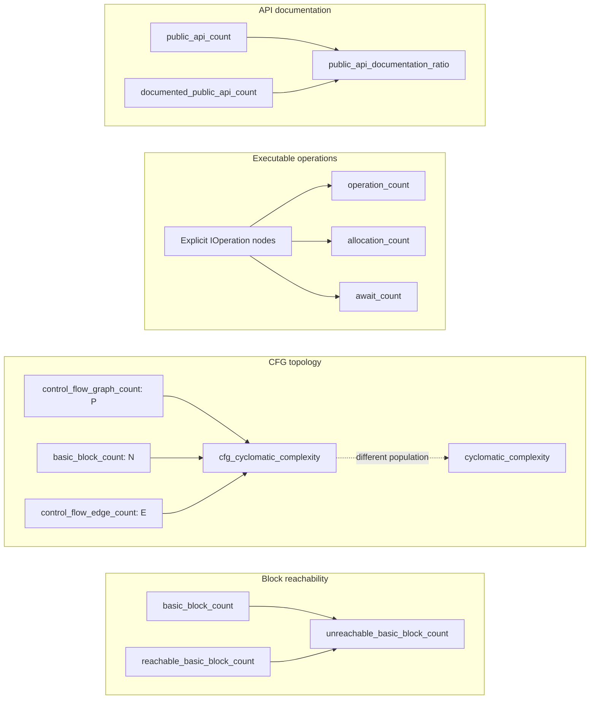

# Choosing and combining metrics

The toolkit publishes **66 metrics**. Use them to find code worth inspecting and to
compare the same source population over time. A large value is not, by itself, a defect.
The [formula reference](../../src/CodeMetricsToolkit.Core/Metrics/README.md) defines
exact populations, versions and limitations; `codemetrics explain <id>` exposes the catalog.

Before interpreting numbers, check `summary.json.analysisHealth`, analysis mode, metric
versions, selected projects, generated-code policy and source-population hash. An absent
metric means **not measured**, not zero. `trusted` describes loading/coverage checks;
it does not mean the program compiles, or that every external symbol resolves.

## Size, layout and duplication

Physical file totals count unique paths. A linked file can belong to several projects,
so summing project LOC can exceed solution LOC. Nested type spans overlap; do not sum
type LOC to estimate repository size. Empty files have one physical line, and a final
newline creates a final empty line. Directives and disabled preprocessor text mean line
categories do not necessarily partition all LOC.

| Metric | What it helps answer | Connection |
| --- | --- | --- |
| `lines_of_code` | How much physical source is in this file/type/project/solution? | Denominator for line ratios; context for complexity. |
| `token_line_count` | How much source contains C# tokens? | Excludes standalone comments; includes all lines of multiline tokens. |
| `blank_line_count` | How much space is used for visual separation? | Numerator of `blank_line_ratio`; whitespace inside comments/strings is excluded. |
| `comment_only_line_count` | How much text is standalone commentary? | Part of `commented_line_count`. |
| `commented_line_count` | How many lines contain any comments? | `comment_only_line_count + mixed_code_comment_line_count`. |
| `mixed_code_comment_line_count` | How often do code and comments share a line? | Intersection of token and comment lines; do not add both totals. |
| `documentation_comment_line_count` | How much XML documentation text exists? | Subset of comment lines; differs from documented API symbol count. |
| `token_line_ratio` | How dense is the physical layout? | Token lines / LOC; not a quality score. |
| `blank_line_ratio` | What share of source is whitespace? | Blank lines / LOC. |
| `comment_only_line_ratio` | What share is standalone commentary? | Comment-only lines / LOC. |
| `commented_line_ratio` | What share carries comments? | Commented lines / LOC; overlaps token ratio. |
| `documentation_comment_ratio` | How much source is XML documentation? | Documentation lines / LOC; use API coverage for symbol coverage. |
| `duplicated_block_count` | Where are repeated exact-token regions? | Merged occurrences, not clone pairs; tagged file rows locate regions. |
| `duplicated_line_count` | How much physical source participates in duplication? | Union of lines in regions, counted once per file. |
| `duplicated_line_ratio` | How extensive is duplication relative to source size? | Duplicated lines / LOC; names and literal values must match. |
| `type_count` | How many type declarations share a file? | Partial declarations count separately; graph nodes represent logical types. |
| `member_count` | How many logical members belong to a type/file? | Population for complexity/length aggregates; not all C# symbols. |
| `member_length` | Which declarations are long enough to inspect? | Input to max/p95 and member hotspot ranking. |
| `parameter_count` | Which member signatures require substantial input context? | Read alongside length, coupling and complexity; setters' implicit `value` is excluded. |

Duplication requires 100 consecutive matching tokens spanning at least 10 lines in each
occurrence. A same-file match must be at least 100 tokens away. The collector makes a
fixed number of token passes without enumerating matching pairs. It has no separate
token/window/work ceiling; its in-memory indexes grow with the selected source size.

Arrows in these graphs mean **input to a calculation or aggregation**. They do not imply
causation or that improving one number improves another. Dashed arrows below mean an
interpretive comparison, not a formula.

## Complexity and distributions

These metrics use declared methods, constructors, properties, indexers, operators and
destructors. Local functions/lambdas contribute syntax decisions to their enclosing
member; top-level statements and field/event initializers do not get member targets.
The cognitive metric is a toolkit baseline, not a Sonar compatibility claim.

| Metric | What it helps answer | Connection |
| --- | --- | --- |
| `decision_point_count` | How much explicit branching exists? | The non-baseline part of syntax cyclomatic complexity. |
| `cyclomatic_complexity` | Which members have many syntactic decisions? | `1 + decision_point_count`; a test-planning signal, not a required test count. |
| `cognitive_complexity` | Where do decisions and their nesting accumulate? | Structural increments use nesting; compare with flat branching and length. |
| `nesting_depth` | Where must readers track deeply nested control flow? | Maximum structural depth; boolean operators do not add depth. |
| `weighted_member_complexity` | How much branching is concentrated in a type? | Sum of logical members' cyclomatic values, including each baseline of 1. |
| `max_member_length` | Is there a single very long member? | Maximum member length in file/type/project/solution. |
| `p95_member_length` | Is large member size widespread? | Nearest-rank p95 of lengths; compare with maximum. |
| `max_member_cyclomatic_complexity` | Where is the worst branching outlier? | Maximum member cyclomatic value. |
| `p95_member_cyclomatic_complexity` | Is branching complexity systemic? | Nearest-rank p95 of member cyclomatic values. |
| `max_member_cognitive_complexity` | Where is the largest reading burden? | Maximum member cognitive value. |
| `p95_member_cognitive_complexity` | Is high reading burden widespread? | Nearest-rank p95 of member cognitive values. |
| `max_member_nesting_depth` | Does the target contain deeply nested code? | Maximum member depth. |
| `max_type_lines_of_code` | Is there an oversized logical type? | Maximum type LOC in project/solution; partial declarations are combined. |
| `p95_type_lines_of_code` | Are large types common? | Nearest-rank p95 of logical type LOC. |

For a sorted nonempty population of size `n`, nearest-rank p95 selects position
`ceil(0.95 × n)`, starting at 1. For 20 observations it selects the 19th; for fewer
than 20 it equals the maximum. Empty populations emit zero aggregates. File member
aggregates use each logical member's primary file; declaration counts use all declarations.

Hotspot ranking combines different components for each target kind. The
[ranking definition](../../src/CodeMetricsToolkit.Core/Metrics/README.md#hotspot_rank200)
specifies their weights. Max length, max depth, WMC, type-size distributions, duplication,
CFG and transitive dependencies are **not** hotspot inputs.

## Dependencies, callers and cycles

Graph metrics need trusted semantic analysis and only count endpoints inside the analyzed
population. A low dependency count in a narrow project slice does not imply low coupling
in the whole system. An edge records a static relationship, not runtime execution.

| Metric | What it helps answer | Connection |
| --- | --- | --- |
| `outgoing_type_dependency_count` | How many internal types does this type depend on directly? | Distinct type endpoints of inheritance, interface and type-use edges; excludes self. |
| `incoming_type_dependency_count` | How many internal types might be affected by changing this type? | Reverse direct dependency count; fan-in alone is not a defect. |
| `transitive_type_dependency_count` | How large is the reachable dependency surface? | Reachability beyond direct dependencies; excludes the starting type. |
| `transitive_type_dependent_count` | How far could a change propagate through static dependencies? | Reverse reachability, not proof of runtime impact. |
| `dependency_cycle_membership` | Is the type part of a dependency cycle? | 1 iff `dependency_component_size > 0`. |
| `dependency_component_size` | How many types are mutually reachable in that cycle? | Cyclic strongly connected component (SCC) size; zero otherwise. |
| `outgoing_project_dependency_count` | How many analyzed projects are directly referenced? | Evaluated direct project references (imports and conditions included); package, implicit transitive compiler references and type-use edges do not count. |
| `incoming_project_dependency_count` | How many analyzed projects reference this project? | Reverse direct project references. |
| `project_dependency_cycle_membership` | Is the project in a direct-reference cycle? | 1 iff its cyclic component size is positive. |
| `project_dependency_component_size` | How many projects participate in that component? | SCC size; self-reference is 1, acyclic is 0. |
| `outgoing_namespace_dependency_count` | Which namespaces are used by this namespace? | Distinct namespaces aggregated from type dependencies; same-namespace edges excluded. |
| `incoming_namespace_dependency_count` | How broadly is this namespace used? | Reverse namespace dependency count. |
| `namespace_dependency_cycle_membership` | Are namespace boundaries mutually dependent? | 1 iff its cyclic component size is positive. |
| `namespace_dependency_component_size` | How broad is a namespace cycle? | SCC size; namespaces are project-scoped, including the global namespace. |
| `distinct_outgoing_callee_count` | How many internal member implementations does a member/type call? | Distinct resolved invocation/construction targets, not call-site count. |
| `distinct_incoming_caller_count` | How many internal members call this member/type? | Distinct calling members; type values union member endpoints. |
| `recursive_component_size` | Is a member directly or mutually recursive? | Call-graph SCC size; self-recursion = 1, nonrecursive = 0. |

An SCC is not the number of simple cycles. Two opposing edges between namespaces may
arise from different types without any type cycle. A source-level cycle does not imply a
project-reference cycle. Call edges omit reflection, dynamic dispatch, callbacks and many
delegate/interface dispatch relationships.

## Semantic API and executable code

| Metric | What it helps answer | Connection |
| --- | --- | --- |
| `inheritance_depth` | How many non-object class bases must a reader understand? | Class-only chain length; interfaces, structs and enums are zero. |
| `type_coupling` | How many named types are needed to understand this type? | Includes external types and generic arguments; unlike internal graph fan-out. |
| `public_api_count` | How large is the externally accessible source API? | Explicit public/protected symbols with accessible containers; not member count. |
| `documented_public_api_count` | How many exposed symbols carry XML documentation? | Subset of public API symbols; measures presence, not usefulness. |
| `public_api_documentation_ratio` | How complete is API documentation coverage? | Documented symbols / public symbols; omitted for an empty API. |
| `operation_count` | How much explicit executable work is represented syntactically? | Roslyn operations excluding implicit nodes and body/block wrappers. |
| `allocation_count` | Where are explicit construction sites concentrated? | Explicit object/array/anonymous-object/delegate creation; not heap bytes or runtime counts. |
| `await_count` | Where are explicit suspension operations written? | Explicit await operations; not elapsed time or scheduling cost. |
| `control_flow_graph_count` | How many executable graphs contribute to the member? | `P` in the CFG formula; accessors can contribute multiple graphs. |
| `basic_block_count` | How large is the member's CFG? | All blocks including entry/exit; `N` in the CFG formula. |
| `reachable_basic_block_count` | How many blocks can be reached according to Roslyn? | Subset of basic blocks; not runtime coverage. |
| `unreachable_basic_block_count` | Is there statically unreachable control flow? | Total blocks minus reachable blocks; inspect before treating as dead code. |
| `control_flow_edge_count` | How many explicit CFG successors exist? | `E` in the CFG formula; excludes branches without destination blocks. |
| `cfg_cyclomatic_complexity` | How complex is the collected CFG topology? | `max(1, E − N + 2P)`; omitted without a CFG, differs from syntax complexity. |
| `diagnostic_count` | What compiler/syntax/nullable observations overlap this target? | Trusted source-span diagnostics across all partial declarations; tags overlap. Third-party analyzers/suppressors are not executed, so counts can differ from a build. |
| `hotspot_rank` | What should be inspected first within this run? | Weighted empirical percentiles, then a global ordinal rank; 1 is highest priority. |

Operations include nested lambda/local-function bodies, but their separate CFGs are not
collected. Exception regions and implicit constructor calls also make CFG and explicit
operation populations differ. The CFG metric is not a full exception-aware path count.
Compiler diagnostics include informational messages; they are not all bugs and do not
include third-party analyzer execution. A diagnostic tagged both `compiler` and `nullable`
counts once in the untagged total, so tagged totals must not be summed.

Read a hotspot together with its raw components and source. For example, a long, flat
mapping switch can rank very highly without being a sensible refactoring candidate;
a smaller nested state transition may warrant more scrutiny. Ranks depend on the
comparison population and are not comparable absolute quality scores across repositories.
